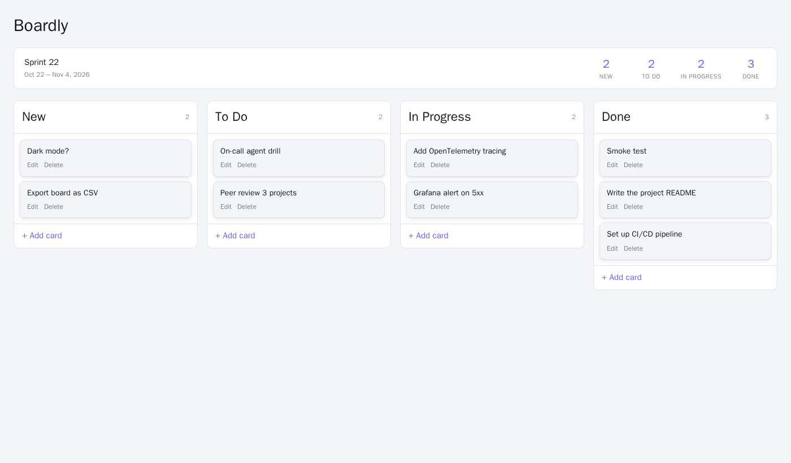

# Boardly

A mini kanban board, taken from a one-paragraph idea to a tested, containerized,
continuously deployed, observable app with an AI on-call agent - built with
coding agents for the [AI Dev Tools Zoomcamp 2026](https://github.com/DataTalksClub/ai-dev-tools-zoomcamp) final project.

## The problem

Small personal projects need just enough planning: a place to dump raw ideas,
pull a few into "to do", work on one or two at a time, and see what got done.
Full tools (Jira, Azure DevOps) are heavy for one person; sticky notes get lost
and do not show progress.

## What Boardly does

- One board, four fixed columns in order: **New** (unrefined ideas) -> **To Do**
  -> **In Progress** -> **Done**.
- Create a card (title required, description optional); it lands in **New**.
- Drag a card to any column; edit or delete it from the card itself.
- A summary bar shows the current two-week sprint and how many cards each column holds.
- Everything is saved in a database and survives refreshes and restarts. If the
  backend is down the UI says so; a failed move or delete is rolled back on screen.

Out of scope on purpose: accounts, multiple boards, custom columns, assignees,
due dates, labels, real-time collaboration. Full spec and acceptance criteria:
[`_docs/specs.md`](_docs/specs.md).



## Quick start

Requirements: Docker with Compose.

```bash
docker compose up -d --build --wait
```

| | |
|---|---|
| App | http://localhost:8080 |
| Grafana dashboard | http://localhost:3000/d/boardly/boardly |

Run every test suite (needs `uv` and Node 22): `make test` (or `scripts/test-all.sh`).

## How it is built

```
browser -> frontend (React + Vite, served by nginx) -/api-> backend (FastAPI) -> Postgres
                      backend --OpenTelemetry--> Collector -> Prometheus / Loki / Tempo -> Grafana
                      Grafana alert --webhook--> on-call responder -> sandboxed Claude Code agent
```

| Area | Where to look |
|---|---|
| Spec and task tracker | [`_docs/specs.md`](_docs/specs.md), [GitHub issues](https://github.com/AlfredoSaira/boardly/issues) |
| Agent team and process | [`docs/agent-team.md`](docs/agent-team.md), [`docs/process.md`](docs/process.md) |
| How AI was used (context, delegation, review, verification) | [`docs/ai-usage.md`](docs/ai-usage.md) |
| Agent instructions | [`AGENTS.md`](AGENTS.md) -> modular [`docs/`](docs/) |
| Architecture | [`docs/architecture.md`](docs/architecture.md) |
| Tests (unit, integration, frontend, smoke) | [`docs/testing.md`](docs/testing.md) |
| Docker, Kubernetes, CI/CD, rollback | [`docs/deployment.md`](docs/deployment.md), [`.github/workflows/ci.yml`](.github/workflows/ci.yml) |
| Metrics, traces, logs, dashboard, alert | [`docs/observability.md`](docs/observability.md) |
| On-call agent (with a real incident) | [`docs/on-call.md`](docs/on-call.md) |
| Skills, subagents, hooks, MCP server | [`docs/agent-extension-pack.md`](docs/agent-extension-pack.md) |
| Permissions and security | [`docs/permissions.md`](docs/permissions.md) |

### Stack

React 19, Vite, @dnd-kit, Vitest + Testing Library · FastAPI, SQLAlchemy,
Postgres 17 (SQLite in tests), uv, pytest, ruff · Docker Compose, nginx,
Kubernetes (kind), GitHub Actions · OpenTelemetry, Prometheus, Loki, Tempo,
Grafana · Claude Code (subagents, skills, hooks, MCP) for development and on-call.

## For reviewers: criteria map

| Criterion | Evidence |
|---|---|
| Problem description | this README |
| Product specification | [`_docs/specs.md`](_docs/specs.md) + [issues with acceptance criteria](https://github.com/AlfredoSaira/boardly/issues?q=is%3Aissue) referenced by commits |
| Agent team | [`docs/agent-team.md`](docs/agent-team.md), [`docs/ai-usage.md`](docs/ai-usage.md), [`.claude/agents/`](.claude/agents/), [`incident-response/`](incident-response/) |
| Context management | [`AGENTS.md`](AGENTS.md) -> [`docs/`](docs/) |
| Application | `docker compose up -d --build --wait` -> http://localhost:8080 (React -> FastAPI -> Postgres) |
| Testing | `make test`: backend unit + integration (real server, Postgres in CI), frontend, responder, MCP, hooks |
| Containerization | [`compose.yaml`](compose.yaml): app + Postgres + observability, one command |
| Deployment | [`docs/deployment.md`](docs/deployment.md): Kubernetes deploys from CI with smoke test and rollback, logs in the Actions tab, plus [local evidence](docs/evidence/) |
| CI/CD | [`ci.yml`](.github/workflows/ci.yml): tests on every PR; push to `main` deploys to dev automatically, prod after manual approval |
| Observability | [`docs/observability.md`](docs/observability.md): metrics + traces + structured logs sharing the trace id, no user content |
| Alerting on user impact | [`rules.yaml`](observability/grafana/provisioning/alerting/rules.yaml): failed board actions (5xx) |
| On-call agent | [`docs/on-call.md`](docs/on-call.md): alert -> agent fixes the bug -> redeploy -> verified recovery, with a recorded real incident |
